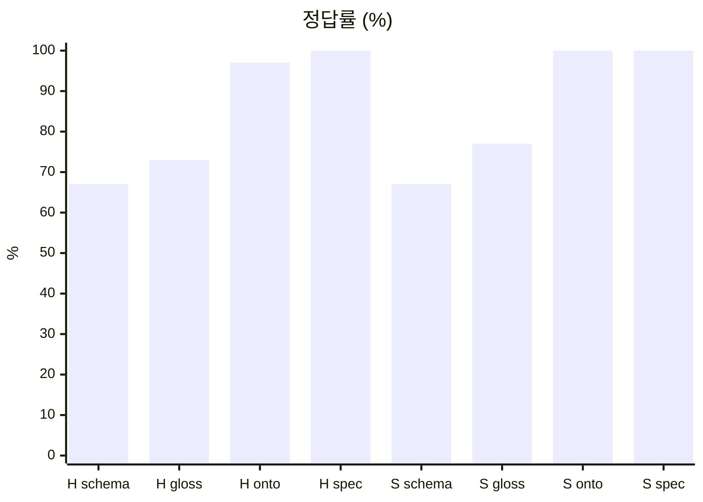

<div align="center">

# 🗄️ ontology-sql-bench

**DB 챗봇에게 온톨로지를 주면 정말 더 정확하게 답할까?**

같은 인사 DB 질문 30개를 지식 문서만 바꿔 가며 Claude Code에 묻고, 정답 SQL 결과와 비교합니다.


</div>

---

## 📌 한눈에 보기

- **질문**: 스키마 · 용어집 · 온톨로지 · 업무 규칙 중 무엇을 주면 DB 질문에 잘 답하나?
- **DB**: 가상회사 '온톨컴퍼니' 인사 DB (직원 300명 · 3년치, 시드 고정)
- **방법**: 질문마다 빈 폴더 → 같은 과제 → 다른 지식 문서 → 정답과 비교
- **측정**: 정답률 (등급별) · 비용(USD) · 시간 · 턴 수
- **짝 실험**: [ontology-coding-bench](https://github.com/kyungchan3007/ontology-coding-bench) — 같은 회사의 연차 규정으로 코딩 실험

---

## 📊 1차 결과 (2026-11-01, 240회)

> 모델 2 × 조건 4 × 질문 30, effort low, 1회

### 정답률

| 조건 | Haiku 5.5 | Sonnet 5.5 |
|---|---:|---:|
| schema-only | 67% | 67% |
| glossary | 73% | 77% |
| ontology | 97% | **100%** |
| spec | **100%** | **100%** |



### 등급별 정답률 (Sonnet)

| 조건 | simple | join | rule | trap |
|---|---:|---:|---:|---:|
| schema-only | 100% | 88% | 13% | 67% |
| glossary | 100% | 100% | 38% | 67% |
| ontology | 100% | 100% | 100% | 100% |
| spec | 100% | 100% | 100% | 100% |

- Haiku도 같은 모양 (ontology trap만 83%)

### 질문 1개당 비용 · 시간

| 조건 | Haiku 5.5 | Sonnet 5.5 |
|---|---:|---:|
| schema-only | $0.27 · 14s | $0.19 · 13s |
| glossary | $0.22 · 11s | $0.18 · 10s |
| ontology | $0.23 · 10s | $0.19 · 11s |
| spec | $0.23 · 11s | $0.19 · 11s |

### 정리

- **규칙이 담긴 문서(ontology · spec)를 주면 97~100%**
- **스키마만 주면 67%** — 단순 조회는 다 맞히지만 회사 규칙 질문은 13%
- **용어집은 +6~10%p뿐** — 용어 뜻만으로는 "누구를 세는지"를 못 맞힘
- **ontology vs spec은 차이 거의 없음**
  - Haiku ontology가 1문제(Q30) 틀린 것만 차이
- **문서를 더 줘도 비용은 그대로**
  - 규칙을 모르면 오히려 더 헤맴 (Haiku schema-only 턴 8.4 vs spec 6.9)
- **Sonnet이 Haiku보다 싸고 정확함** (코딩 실험과 같은 방향)
  - Haiku 출력 토큰이 약 1.9배
- 총비용: $50.64 (질문당 대부분은 Claude Code 기본 컨텍스트 비용)

### 자주 틀린 질문 (schema-only · glossary)

| 질문 | 틀린 이유 |
|---|---|
| Q17 직원 수 | 임원 · 휴직자 규칙 모름 |
| Q18 평균 연봉 | 임원 · 수습 제외 모름 |
| Q19 지급된 성과급 | 비율 · 지급 시점 모름 (답 포기 3회) |
| Q21 연차 수당 | 0.5일 내림 · 대상 모름 |
| Q22 영업본부 인원 | 하위 부서 합 · 임원 제외 모름 |
| Q27 연봉 합계 | 천 원 단위 · 수습 제외 모름 |
| Q30 성과급 못 받은 A등급 | 지급 조건 모름 (답 포기 3회) |

### 문서가 있어도 틀린 1건

- Haiku · ontology · Q30: 임원을 "받지 못한 사람"에서 뺌 → 0명 (정답 2명)
  - 임원은 평가를 받아도 성과급이 없으니 세야 함

### 채점 공정성 메모

- Haiku · glossary · Q28 "병가로 빠진 소정근로일은 모두 며칠"
  - 답 128 = 날짜 중복 제거, 정답 172 = 사람별 일수 합
  - 질문 문구가 애매할 수 있음 → [#2](https://github.com/kyungchan3007/ontology-sql-bench/issues/2)
- 원본: [`results/2026-11-01-run1.md`](results/2026-11-01-run1.md)

---

## 🔁 2차 결과: 3회 반복 · 하네스 다이어트 (2026-11-01, 330회)

> 1차를 1회차로 쓰고 2 · 3회차 추가. 근거: [Demystifying evals for AI agents](https://www.anthropic.com/engineering/demystifying-evals-for-ai-agents)

### 3회 반복 (pass^3 = 3번 다 맞힌 질문 비율)

| 모델 | 조건 | 정답률 | pass^3 | 질문당 비용 |
|---|---|---:|---:|---:|
| Haiku | ontology | 99% | 97% | $0.23 |
| Haiku | spec | 97% | 90% | $0.23 |
| Sonnet | ontology | **100%** | **100%** | $0.20 |
| Sonnet | spec | 97% | 90% | $0.19 |

- **한 번 맞힌다고 매번 맞히는 건 아님** — spec은 정답률 97%여도 pass^3 90%
- **Sonnet + ontology만 90문항 전부 정답**
- ontology vs spec 차이는 작고, 표본도 적음 (질문 30개 × 3회)

### 흔들린 질문

| 질문 | 틀린 이유 |
|---|---|
| Q30 성과급 못 받은 A등급 | 임원을 "못 받은 사람"에서 뺌 (6회) |
| Q21 연차 수당 | `연봉/12/209*8`을 정수 나눗셈으로 → 단계마다 버림 (2회) |
| Q18 평균 연봉 | 수습 경계 계산 차이 (1회) |
| Q15 등급별 기록 수 | 임원 기록을 뺌 (1회) |
| Q02 S등급 건수 | 답 파일 미작성 (1회) |

- Q21은 SQLite 정수 나눗셈 함정: 규정은 "÷12 ÷209 ×8 후 원 미만 버림"
- Q30 · Q15는 "임원 제외"를 질문 범위에까지 넓혀 적용한 실수

### 하네스 다이어트 (Sonnet · spec, 3회)

| 하네스 | 정답률 | pass^3 | 질문당 비용 | 입력 토큰 |
|---|---:|---:|---:|---:|
| 기본 | 97% | 90% | $0.186 | 143k |
| lean | **98%** | **97%** | **$0.097** | 47k |

- lean = `--tools Read,Write,Bash` + 짧은 `--system-prompt`
- **비용 −48%, 정확도는 그대로**
- 사내 DB 챗봇에는 범용 코딩 에이전트 지시문이 필요 없음
- 2차 총비용: $59.37
- 원본: [`results/2026-11-01-run2-repeat-lean.md`](results/2026-11-01-run2-repeat-lean.md)

---

## 🧾 지금까지의 결론

- **규칙이 담긴 문서가 핵심** — 스키마만 67%, 용어집 73~77%, 규칙 문서 97~100%
- **문서 모양(ontology vs spec)은 작은 차이** — Sonnet ontology만 pass^3 100%
- **가성비 1위: Sonnet + 규칙 문서 + effort low + lean 하네스** ($0.10/질문)
- 코딩 실험과의 차이
  - 코딩: 문서만 있으면 모양 무관, 전부 100%
  - 챗봇: "누구를 세는가" 같은 규칙이 문서에 있어야 맞힘

---

## 🤔 왜 이 실험을 하나

- 출발점: [단테](https://www.youtube.com/watch?v=bZJa_I8EnUc) 채널의 온톨로지 실험 영상
  - 보험 DB 챗봇에서 온톨로지를 주면 정답률이 올라감
- 코딩 실험에서는 **문서만 있으면 모양은 상관없었음** (전 조건 100%)
- 그런데 DB 질문은 다름
  - 스키마만 보고는 알 수 없는 **회사 규칙**이 답을 바꿈
  - 예: "직원 수"에 임원 · 휴직자 · 수습을 넣는가?
- 이 저장소는 그 차이를 잽니다

---

## 🏢 도메인: 온톨컴퍼니 인사 DB

| 영역 | 규칙 예 |
|---|---|
| 조직 | 본부 → 실 → 팀, 본부 인원 = 하위 부서 합 |
| 소속 | 주소속만 인원으로, 겸직은 제외 |
| 재직 | 휴직자 포함, 퇴사자 제외 |
| 임원 | 직원 집계 · 평균 연봉 · 성과급 제외 |
| 연봉 | 천 원 단위, 적용 시작일 이력 |
| 수습 | 입사 3개월 이내, 평균 연봉 제외 |
| 성과급 | S 20% · A 10% · B 5%, 다음 해 3/31 지급 |
| 근태 | 육아휴직 · 산재 · 예비군은 출근 간주 |
| 연차 | 코딩 실험의 연차 규정(R1~R9) 그대로 |

- 전체 규정: [`knowledge/source.md`](knowledge/source.md)
- 기준 시점: **2025-12-31** ("현재" = 이 날)

### 테이블

| 테이블 | 한 행 |
|---|---|
| `departments` | 부서 (21개, 폐지 1) |
| `employees` | 직원 (300명) |
| `emp_depts` | 소속 이력 |
| `salaries` | 연봉 변경 |
| `evaluations` | 연도 평가 |
| `absences` | 결근 · 휴직 |
| `leave_grants` | 연차 발생 |
| `leave_usages` | 연차 사용 |
| `workdays` | 근무일 달력 |

---

## 🪤 DB에 숨은 함정

- `status` = 'L'(휴직)도 재직자
- `dept_old`는 갱신 안 되는 옛 컬럼 → 쓰면 틀림
- 금액 5,000 = **500만 원** (천 원 단위)
- 사유 코드 30 = 육아휴직 → 결근 아님
- 사용 단위 H = 0.5일 → 행 수로 세면 틀림
- "2025년에 지급된 성과급" = **2024년** 평가 기준
- 영업2팀은 2024-07-01 폐지 → 이력으로만 남음
- 임원은 본부 소속 → 본부 인원에서 빼야 함

---

## 🧫 실험 조건

> 모든 조건에 [`task/TASK.md`](task/TASK.md)와 `hr.db`는 똑같이 들어갑니다.

| 조건 | 넣는 지식 문서 |
|---|---|
| `schema-only` | schema.md (DDL) |
| `glossary` | schema + 용어집 |
| `ontology` | schema + 온톨로지 |
| `spec` | schema + 업무 규칙 명세 |

| 문서 | 담은 것 |
|---|---|
| schema.md | 테이블 정의만 |
| glossary.md | 용어 · 코드 뜻 (계산 규칙 없음) |
| ontology.md | 개념 · 속성 · 관계 · 규칙 (전부) |
| spec.md | 업무 규칙 BR + 데이터 사전 (전부) |

- ontology · spec은 `source.md`의 사실을 **모두** 담고 모양만 다름
- glossary는 **용어만** 담아 "규칙이 빠지면?"을 봄

### 질문 30개

| 등급 | 개수 | 예 |
|---|---:|---|
| simple | 8 | 2024년 소정근로일 수 |
| join | 8 | 팀별 주소속 인원 |
| rule | 8 | 2025년에 지급된 성과급 총액 |
| trap | 6 | 2024년 연차 사용 일수 합 |

### 챗봇 구조

- 질문 1개 = `claude -p` 세션 1개 (질문마다 새 폴더)
- 도구: 파일 읽기 · `answer.json` 쓰기 · `sqlite3`만
- DB는 읽기 전용 (`chmod 444` + `-readonly`)
- effort: `low` (코딩 실험 2차에서 정확도 손실 없이 가장 쌌음)
- 채점: `answer` 값 vs 정답 SQL 실행 결과

---

## 📂 폴더 구조

```
ontology-sql-bench/
├── knowledge/              # 지식 문서
│   ├── source.md           # 원본 규정 = 정답 기준
│   ├── schema.md           # DDL
│   ├── glossary.md         # 용어 · 코드
│   ├── ontology.md         # 개념 · 관계 · 규칙
│   └── spec.md             # 업무 규칙 BR
├── task/TASK.md            # 모든 조건 공통 과제
├── data/
│   ├── generate.mjs        # DB 생성기 (시드 고정)
│   ├── schema.sql          # DDL
│   └── leave-rules.mjs     # 연차 규칙 구현
├── bench/
│   ├── conditions.mjs      # 조건 · 모델 · 프롬프트
│   ├── run.mjs             # 실행 + 채점
│   ├── grade.mjs           # 답 비교
│   └── report.mjs          # 결과표
├── hidden/                 # ⚠️ AI에게 절대 보여 주지 않음
│   ├── questions.mjs       # 질문 30개 + 정답 SQL
│   └── answers.mjs         # 정답 계산
├── runs/                   # 실행 원본 (git 제외)
└── results/                # 실행별 결과표
```

---

## ▶️ 실행

- DB 만들기 (같은 시드 → 같은 DB)

```bash
npm run build:db
```

- 정답 보기

```bash
npm run answers
```

- 전체 실험 (모델 2 × 조건 4 × 질문 30 = 240회)

```bash
npm run bench
```

- 일부만

```bash
node --no-warnings bench/run.mjs --models sonnet --conditions spec --questions Q17,Q19
```

- 결과표 (여러 실행 합치기 가능)

```bash
npm run report
node --no-warnings bench/report.mjs <runId1> <runId2>
```

- 2차 재현

```bash
node --no-warnings bench/run.mjs --conditions ontology,spec --reps 2 --rep-start 2
node --no-warnings bench/run.mjs --lean --models sonnet --conditions spec --reps 3
```

| 옵션 | 기본값 |
|---|---|
| `--models` | haiku,sonnet |
| `--conditions` | 4개 전부 |
| `--questions` | Q01~Q30 |
| `--effort` | low |
| `--reps` | 1 |
| `--rep-start` | 1 |
| `--lean` | 꺼짐 |
| `--concurrency` | 4 |

- 필요: Node 22.13+ (`node:sqlite`), `sqlite3` CLI, 로그인된 `claude` CLI

---

## 🚧 진행 상황

- [x] 원본 규정 `source.md`
- [x] DB 생성기 (시드 고정)
- [x] 질문 30개 + 정답 SQL
- [x] 지식 문서 4종
- [x] 실행 · 채점 · 결과표 스크립트
- [x] 1차 실행 (240회)
- [x] 결과 정리
- [x] 3회 반복으로 pass^3 확인
- [x] 하네스 다이어트 (lean)
- [ ] Q28 문구 수정 (#2)

---

## 🙏 출처

- 영상: [단테 — 온톨로지 실험](https://www.youtube.com/watch?v=bZJa_I8EnUc&feature=youtu.be)
  - 따릉이 요금 코딩 실험 · 보험 DB 챗봇 실험
  - 이 저장소는 그중 **챗봇 실험**을 다른 도메인으로 다시 재 본 것
- 데이터는 모두 가상이며 실존 인물 · 회사와 관계없음

## 🔗 관련

- 코딩 실험: [ontology-coding-bench](https://github.com/kyungchan3007/ontology-coding-bench)
